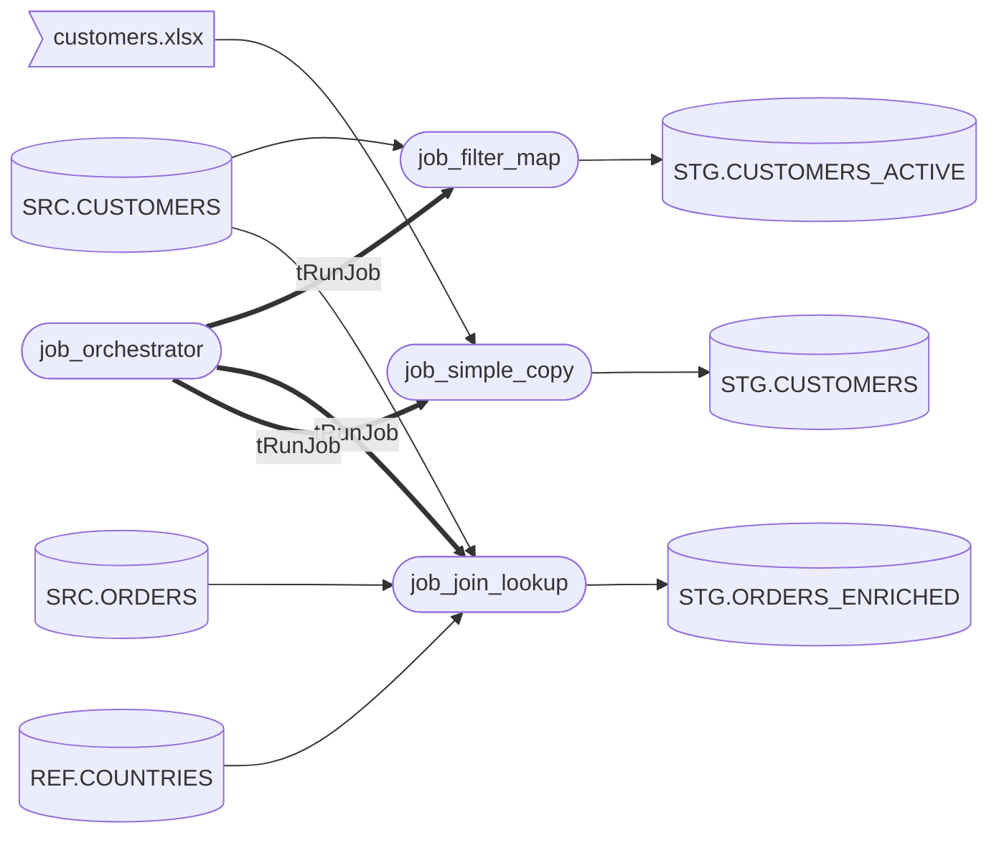

# talend-migration-toolkit (`tmt`)

**See what a complex Talend master job depends on, without opening Studio.** Point `tmt` at a workspace, pick a
master job, and get a dependency graph: the jobs it starts (however deep), the tables and files they read and
write, how many sources and targets there are, and which database connections (Studio metadata connections) are
used, by name: `10x ODS_DB`, `2x AKY_DB`.


<sub>`tmt graph samples/talend --focus job_orchestrator`, abridged.</sub>

## The problem

A migration starts with *discovery*: which jobs does the nightly master job start, what do they read and write, and
which databases do they touch? Clicking through hundreds of jobs in Studio to answer that is slow and error-prone.
`tmt` reads the job files directly (static analysis only: nothing is executed, no database is touched) and draws it.

## Quick start

Python 3.11+.

```bash
pip install -e ".[dev]"
tmt ui
```

`tmt ui` opens the **Dependency Explorer** in your browser, laid out like a Talend Studio perspective:

1. **Workspace** (title bar): the folder that holds your Talend projects; there is a folder browser.
2. **Repository** (left): master jobs are listed first under *Job Designs*. Click one to open it; the arrow shows
   the jobs it starts. *Db Connections* lists the metadata connections in use; click one to light up the jobs that use it.
3. **Designer** (centre): the dependency graph in a tab. Hover (or Tab to) a job or table to see how many sources and
   targets it has and which connections it uses; click to keep the details open, Esc closes them. *Save as SVG* exports the picture.
4. **Properties** (right) and the bottom lists: distinct sources and targets of the whole workflow, and the connections:

   ```text
   job_master_daily:  12 sources · 10 targets
   2 different connections in use:  10x ODS_DB (3 jobs)   2x AKY_DB (2 jobs)
   ```

No workspace at hand? Press *Open the demo project* (`samples/talend_demo`). It runs only on your computer
(loopback address, private token, read-only: it never writes a file or starts a process); nothing is uploaded.
Details and the security model: [docs/ui.md](docs/ui.md).

## For many users and servers: the portable folder

`python tools/build_portable.py` builds `dist/tmt/` (embedded Python, dependencies and `tmt`, about 60 MB): zip that
folder and hand it over. On a server, every user double-clicks **`Start tmt.bat`**: no installation, no
administrator rights, works offline, and each user sees their own workspace (found automatically, or chosen once).
`Start tmt.bat` in the project root is the same launcher for development. See [docs/deployment.md](docs/deployment.md).

## Commands

| Command | Does |
|---|---|
| `tmt ui [WORKSPACE] [--port N] [--no-browser]` | The dependency explorer in your browser ([docs/ui.md](docs/ui.md)). |
| `tmt graph <path> [--master JOB \| --focus JOB] [--format mermaid\|dot\|json\|svg] [--out DIR]` | The lineage graph. `--master` keeps one job and every job it starts and prints its numbers (jobs, sources, targets, connections) on stderr; `--focus` keeps one job with its upstream and downstream. JSON also carries the analysis (order, cycles, orphan tables, unresolved tables). |
| `tmt scan <path> [--out DIR]` | The model: `DIR/model/<job>.json`, `_all.json` and, if anything failed, `_errors.json`. |
| `tmt parsers` | Lists the installed parsers (built-in and plugins). |

Common options: `--context NAME` (context group used to fold `context.*` values), `--config FILE`
(complexity weights, see below), `--parser NAME`, `-q`, `-v` / `-vv`, `--fail-on-unsupported`.

**Behaviour you can rely on**

* Results go to stdout, diagnostics to stderr, so `tmt graph ... | mmdc ...` and `tmt graph --format json | jq` work.
* Status is written in words, never by colour alone; `NO_COLOR` is honoured.
* Mistakes get a message and a next step (`error: ...` / `hint: ...`), never a stack trace.
* Exit codes: **0** success; **1** some jobs could not be parsed (listed; the rest was still processed);
  **2** usage or configuration error, or `--fail-on-unsupported` found an unsupported component.

## Database connections

Studio keeps a reusable connection as a repository item (`metadata/connections/<Name>_0.1.item`); a component points
at it by id. `tmt` resolves that id to the connection's name (also across the projects of a workspace), follows
components that share a `t<DB>Connection`, and counts the database components that use each name. When the link
to the repository item is gone but Studio's context variables remain (`context.ODS_DB_Host`...), the name is
**inferred** from them and marked `*`. Built-in settings and unresolvable placeholders are listed as such, never
guessed. Passwords and user names are never read. Details: [docs/talend_format_notes.md](docs/talend_format_notes.md).

## Complexity badge

Every job also gets an easy/medium/hard badge (shown in the explorer and in `scan`): a weighted sum of facts
found in its model, so a score can always be explained. Defaults (edit them in
[config.example.yaml](config.example.yaml)):

| Factor | Points |
|---|---|
| each component | +1 |
| each tMap lookup join | +2 |
| each tMap expression that calls Java methods | +3 |
| each `tJava` / `tJavaRow` / `tJavaFlex` / custom routine call | +10, **forces hard** |
| each unsupported component | +5 |
| each `tRunJob` child | +2 |
| each table/SQL target that depends on a context variable | +2 |

**easy** <= 10, **medium** 11-25, **hard** > 25 (or any custom Java).

## What it understands

Target: **Talend Studio 8.0.1**, Data Integration (Standard) jobs, `.item` files with their `.properties`.
Format details: [docs/talend_format_notes.md](docs/talend_format_notes.md).

| Category | Components | Status |
|---|---|---|
| Inputs | `tFileInputExcel`, `tFileInputDelimited`, `JDBCInput` (+ `tFixedFlowInput`, no source) | files, tables and SQL extracted |
| Outputs | `tFileOutputDelimited`, `JDBCOutput` | target + action (insert/update/upsert/delete) |
| Raw SQL | `tOracleRow`, `tDBRow`, query of `JDBCInput` | parsed with sqlglot: tables read and written |
| Transform | `tMap`, `tAggregateRow`, `tUniqRow`, `tSortRow`, `tUnite` | logic recorded in the model |
| Control | `tRunJob`, `tPrejob`, `tPostjob`, triggers (`OnSubjobOk`, `OnComponentOk`, `RunIf`) | orchestration graph |
| Custom code | `tJava`, `tJavaRow` | **detected, flagged, code kept verbatim** |
| `t<DB>Input/Output/Row`, `t<DB>Connection` (other vendors) | | handled by pattern, flagged `unverified_component` until a real sample confirms it |
| Anything else | | kept as `supported=false` with a warning, never dropped |

## Real workspaces

A workspace usually holds several projects, and a project cloned from another repeats every job name and id. `tmt`
gives each job a unique key (`job_x` when the name is unique, `job_x@PROD` otherwise), resolves `tRunJob` children
by `(project, id)` as Studio writes them, and never lets one job overwrite another in the output.

```bash
tmt graph path/to/Talend_WS --master job_x@PROD --format svg --out out
```

## Design philosophy: flags, never guesses

- Unknown or unsupported content is **recorded and flagged** (`Issue` with a closed `IssueCode`), never silently
  dropped.
- Table names that depend on a context variable are marked `context_dependent`; the graph draws those
  edges dashed and shows the raw expression when it cannot be folded.
- Secrets are never copied: context passwords and `PASSWORD` fields are absent from every output.
- XML is parsed with entities and DTDs disabled; nothing extracted from a job is ever executed.
- Output is deterministic (sorted, no timestamps): the same input gives byte-identical files.

## Limitations

- Static analysis of Standard (Data Integration) jobs only. Big Data/Spark/streaming, Routes, Data Services
  and Talend Cloud artifacts are out of scope.
- Jobs produced by a migration tool often hold placeholders (`$Stage.READER.Query`) instead of the real SQL. `tmt`
  flags them (`placeholder_value`); the SQL is not in the job file.
- Java in `tJava`/`tJavaRow` is *classified*, not understood.
- A `tRunJob` whose child is chosen by a context variable cannot be followed statically; it is flagged.

## Sample data

`samples/talend/` and `samples/talend_demo/` hold **synthetic** jobs (generic customers/orders tables, placeholder
hosts, no real credentials). Never commit real customer jobs. See [samples/talend/README.md](samples/talend/README.md).

## Development

```bash
pip install -e ".[dev]"
pytest --cov=tmt          # unit, contract (every parser), integration, golden, fuzz, docs consistency
ruff check src tools tests
mypy                      # strict
UPDATE_GOLDEN=1 pytest tests/integration/test_golden.py   # regenerate goldens, then review the diff
```

## Extending `tmt`

Parsers only produce the intermediate model ([src/tmt/models.py](src/tmt/models.py)); lineage, scoring and the
explorer consume only that model. Support for another ETL tool is a separate package that registers a
`BaseParser` through an entry point, with no change to `tmt`:

* [docs/architecture.md](docs/architecture.md): layers, data flow, design rules and where they are enforced
* [docs/adding_a_parser.md](docs/adding_a_parser.md): write, register and test a parser; ships a reusable
  contract test (`tmt.testing.contract.ParserContract`)
* [docs/talend_format_notes.md](docs/talend_format_notes.md): what was observed in real Talend 8.0.1 files

## Contributing & license

Issues and PRs welcome; see [CONTRIBUTING.md](CONTRIBUTING.md) and [CHANGELOG.md](CHANGELOG.md). Keep changes small,
add a test, and run the checks above. Licensed under the MIT License (see [LICENSE](LICENSE)).
