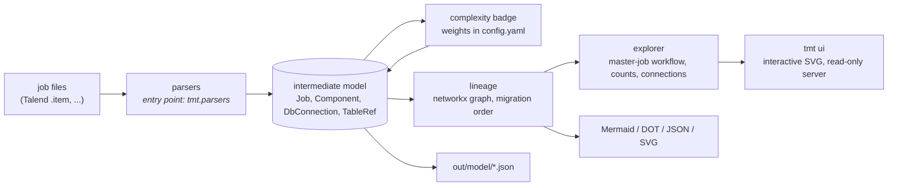

# Architecture

`tmt` is a pipeline with one rule: **parsers produce the intermediate model, everything else consumes only that
model.** Nothing downstream knows which ETL tool a job came from.

## Layers and where they live

| Layer | Module | Knows about |
|---|---|---|
| Model | `tmt/models.py` | nothing else: pydantic, `extra="forbid"`, JSON-serialisable |
| Parsers | `tmt/parsers/` (`base.py` = interface, `registry.py` = discovery, `talend/` = v1 parser, `talend/connections.py` = metadata connections) | one tool's file format and the model |
| Scan | `tmt/scan.py` | parsers (via the interface), the model, scoring |
| Scoring | `tmt/scoring/complexity.py`, `tmt/config.py` | the model only |
| Lineage | `tmt/lineage/builder.py` (graph, order), `explore.py` (one master job's workflow), `svg.py` (picture) | the model only |
| UI | `tmt/ui/` (`server.py` read-only loopback server, `index.html` single page) | scan, lineage |
| CLI | `tmt/cli.py` | everything above, nothing is implemented here |

The dependency arrows only point from the CLI downward, and nothing outside `tmt/parsers/talend/` imports
Talend-specific code. That is what makes a second parser a one-package job
([adding_a_parser.md](adding_a_parser.md)); it is enforced by running the same contract tests against the real
parser and a deliberately tiny dummy one (`tests/contract/`).

## One master job, end to end

1. `scan.discover` lists files; each parser is asked `can_parse(path)` (cheap: extension plus a few bytes).
2. The first parser that accepts a file parses it into a `Job`. A `ParseError` becomes a `Failure` record;
   the run continues.
3. `scan.link_children` resolves `tRunJob`-style child references across jobs by `(project, id)`;
   `scoring.score_jobs` fills `Job.complexity`.
4. `explore.hierarchy` follows the child references from the master job; `explore.explore` builds the graph for
   those jobs and counts the distinct sources, targets and database connections.
5. `svg.to_svg(..., interactive=True)` draws it; the page shows the details on hover.

## Design rules (and where they are enforced)

| Rule | Enforcement |
|---|---|
| Flags, never guesses: unknown content is kept and flagged | closed `IssueCode` enum; `unsupported`/`unverified` flags; connection names inferred from context variables are marked `inferred` |
| Deterministic output: same input gives byte-identical files | sorted lists and keys, no timestamps; golden tests |
| Static analysis only | XML parsed with entities and DTDs off; extracted code is never executed (tests: XXE, entity bomb) |
| No secrets in output | password fields and `id_Password` values are never copied; contract test `secret_markers` |
| One bad job never stops a run | per-job `Failure` records, exit code 1 after finishing; broken plugins are skipped with a warning |
| The UI server only reads | no subprocess, no file writes, no file serving; a test fails if the module starts a process |

## Extension points

* **Parsers**, group `tmt.parsers`: a `BaseParser` subclass. See [adding_a_parser.md](adding_a_parser.md).

Discovered through Python entry points (`importlib.metadata`), validated, and skipped with a warning if broken, so
a faulty plugin can never take the tool down. `tmt parsers` lists what is installed.

## Why these choices

* **A model between parser and everything else.** Lineage, scoring and the explorer are the same work for every ETL
  tool; only reading the files differs.
* **`FLOW`/`MAIN`, `lineStyle`, Java-as-values** are Talend facts and live in `parsers/talend/`; the model speaks
  in `ConnKind`, `Resolution` and `TableRef`.
* **Expressions are classified, not evaluated.** `Resolution` (resolved / context-dependent / unresolved) is
  what lineage and scoring actually need.
* **Entry points over a plugin folder.** Standard packaging, no path tricks, works with `pip install`.
